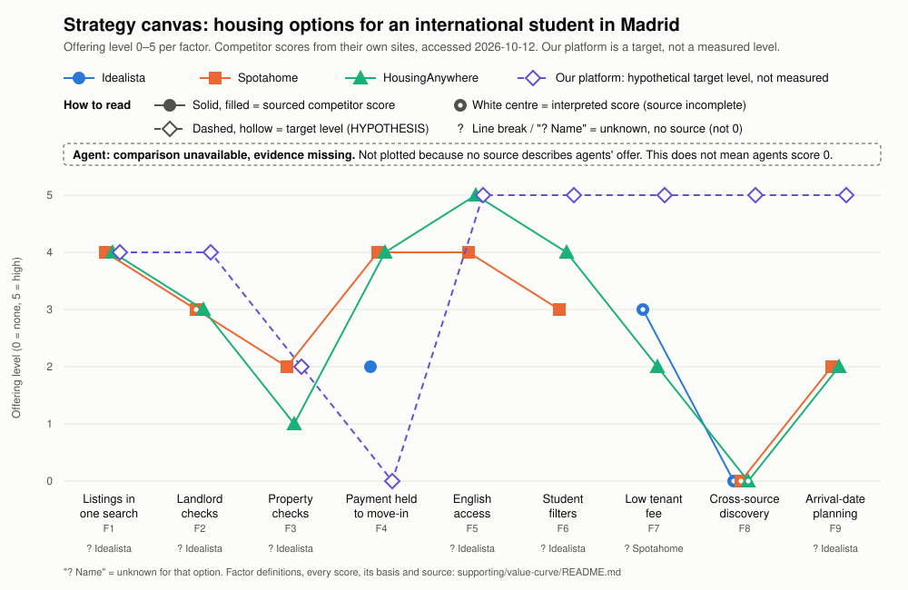

# Value curve

The strategy canvas behind the [ERRC grid](../../evidence-log/ERRC.md). It shows where the options a student can use today sit on the factors in [competitors.md](../market/competitors.md), and where our platform would need to sit if the ERRC moves work.

Chart file: [value-curve.svg](value-curve.svg). Regenerate it with `python3 supporting/value-curve/make_value_curve.py` (standard library only) after changing a score; the scores live in that script and in the table below, and must match.

## How to read this

- **Competitor scores are market evidence only.** They come from what each company states on its own site, as recorded in [competitors.md](../market/competitors.md) (accessed 2026-10-12). They show what is offered, not what students choose or value.
- **Our platform's scores are hypothetical target levels**, not features that exist or have been tested. In the chart they are a dashed line with hollow markers. Each target depends on the tests named in its row.
- **Basis** for each score:
  - **Sourced:** the scale below applied directly to a stated fact.
  - **Interpretation:** our judgement, because the source is incomplete (for example, a check is claimed but its method is not stated). White centre on the chart marker.
  - **Unknown:** no source states it. Shown as a gap in the line, never as 0.
  - **Target (HYPOTHESIS):** our platform only.
- **Spotahome and HousingAnywhere are plotted separately.** They differ on property checks, English help, filters and fees, so one combined line would hide a difference.
- **Agent comparison unavailable: evidence missing.** The agent is not plotted because no source in the repo describes what Madrid rental agents offer. This does not mean agents score 0 on any factor. The only signal, "pay agents (expensive)", is reported in [opportunity.md](../../evidence-log/opportunity.md#situation--problem) without a source. TODO (team): record what 2–3 agents used by IE students offer (fee, checks, languages, coverage) with a link and date, then score them.
- S-numbers are the sources in [competitors.md](../market/competitors.md#sources), all accessed 2026-10-12.

## Factors and scale

The 0–5 anchors are a team-defined scale, so that every option is scored the same way. Levels between anchors are used only where the definition says so.

| Code | Factor | 0 | 1–2 | 3 | 4–5 |
|---|---|---|---|---|---|
| F1 | Listings in one search (Madrid, on the day opened) | None | 1: under 100; 2: 100–999 | 1,000–4,999 | 4: 5,000–19,999; 5: 20,000 or more |
| F2 | Landlord checks | None stated | 1: email or phone only; 2: ID or bank checks on some landlords only | ID or bank checks stated for every landlord | 4: identity plus proof of ownership on some listings; 5: on every listing |
| F3 | Property checks (listing matches the flat) | None stated | 1: no check before booking, mismatch claim after move-in only; 2: photo, video or staff check on some listings | Such a check on every listing | 4: in-person visit on some listings; 5: on every listing |
| F4 | Payment held until move-in | None | 2: on some products or listings only | – | 4: first rent held until after move-in on every booking; 5: plus deposit protection on every booking |
| F5 | English access | Spanish only | 2: partly in English | Full English interface | 4: English plus other languages; 5: plus stated human help in those languages |
| F6 | Student filters | None | 1: price and size only; 2: room types | Move-in date or stay length | 4: dates plus student room types; 5: plus distance to campus |
| F7 | Low tenant fee | – | 1: more than half a month's rent; 2: 25–50% of a month's rent | One-off fee capped at €200 or less | 5: no fee charged to the tenant |
| F8 | Cross-source discovery | Own inventory only | 2: links out to other channels | – | 5: one search across several sources, duplicates merged |
| F9 | Arrival-date planning | None | 2: move-in date filter | – | 5: plan with a sign-by date counted back from arrival, with reminders |

## Scores

| Factor | Idealista | Spotahome | HousingAnywhere | Agent | Our platform (target) |
|---|---|---|---|---|---|
| F1 Listings in one search | unknown | 4 | 4 | unknown | 4 |
| F2 Landlord checks | unknown | 3 (interp.) | 3 | unknown | 4 |
| F3 Property checks | unknown | 2 | 1 | unknown | 2 |
| F4 Payment held to move-in | 2 | 4 | 4 | unknown | 0 |
| F5 English access | unknown | 4 | 5 | unknown | 5 |
| F6 Student filters | unknown | 3 | 4 | unknown | 5 |
| F7 Low tenant fee | 3 (interp.) | unknown | 2 | unknown | 5 |
| F8 Cross-source discovery | 0 (interp.) | 0 (interp.) | 0 (interp.) | unknown | 5 |
| F9 Arrival-date planning | unknown | 2 | 2 | unknown | 5 |

## Why each score

| Factor | Option | Score | Basis | Justification | Source |
|---|---|---|---|---|---|
| F1 | Idealista | unknown | Unknown | Calls itself the leading marketplace in Spain, Portugal and Italy, but no Madrid count: the site blocked automated access | [S2](https://www.idealista.com/en/news/property-for-sale-in-spain/2026/03/13/887103-idealista-launches-its-app-on-chatgpt) |
| F1 | Spotahome | 4 | Sourced | 10,190 Madrid listings shown | [S13](https://www.spotahome.com/s/madrid) |
| F1 | HousingAnywhere | 4 | Sourced | 9,340 Madrid listings shown | [S17](https://housinganywhere.com/) |
| F1 | Our platform | 4 | Target (HYPOTHESIS) | At least the largest single source; how many sources we may combine depends on the legal review (question 2) and whether they matter on [Card 1](../../evidence-log/experiment-card.md#card-1-supply-audit) | [legal-review-brief.md](../research/legal-review-brief.md#questions) |
| F2 | Idealista | unknown | Unknown | Landlord checks on normal ads unconfirmed; Idealista says platforms cannot check landlord-supplied data such as large-holder status | [S3](https://www.idealista.com/news/inmobiliario/vivienda/2026/10/08/917982-los-anuncios-de-alquiler-tendran-que-incluir-nuevos-datos-desde-octubre) |
| F2 | Spotahome | 3 | Interpretation | Says its Trust and Safety team verifies each landlord; what is checked is not stated | [S12](https://www.spotahome.com/how-it-works) |
| F2 | HousingAnywhere | 3 | Sourced | Email, ID, selfie and KYC checks; landlords and bank accounts verified with Stripe | [S16](https://housinganywhere.com/renting), [S18](https://housinganywhere.com/secure-payments) |
| F2 | Our platform | 4 | Target (HYPOTHESIS) | Level 2 adds proof of ownership (*nota simple*) for private landlords, but Level 0 listings are still shown, so not every listing | [verification.md](../verification.md#verification-levels) |
| F3 | Idealista | unknown | Unknown | No property check found in the sources read; listing checks on normal ads unconfirmed | [competitors.md](../market/competitors.md#competitor-table) |
| F3 | Spotahome | 2 | Sourced | "Checked" properties match the listing, but not every listing has the badge | [S12](https://www.spotahome.com/how-it-works), [S13](https://www.spotahome.com/s/madrid) |
| F3 | HousingAnywhere | 1 | Sourced | No property inspection claimed; refund if the place is very different from the listing | [S18](https://housinganywhere.com/secure-payments) |
| F3 | Our platform | 2 | Target (HYPOTHESIS) | Live video walk-through compared with photos at Level 2. Level 4 visits are not counted: their payment model is undecided | [verification.md](../verification.md#verification-levels) |
| F4 | Idealista | 2 | Sourced | First month held until 48 h after move-in, for Online Room Booking only | [S1](https://www.idealista.com/en/news/property-for-rent-in-spain/2025/12/03/873976-idealista-launches-online-room-booking) |
| F4 | Spotahome | 4 | Sourced | First month sent to the landlord 48 h after move-in; deposit protection only on badged listings, so not 5 | [S12](https://www.spotahome.com/how-it-works) |
| F4 | HousingAnywhere | 4 | Sourced | Rent held until 48 h after move-in, with refund on mismatch; deposit protection not stated | [S18](https://housinganywhere.com/secure-payments) |
| F4 | Our platform | 0 | Target (HYPOTHESIS) | No payment holding of our own in the first version, per the competitor review; a booking made on a source platform keeps that platform's protection. TODO (team): confirm | [competitors.md, "So what"](../market/competitors.md) |
| F5 | Idealista | unknown | Unknown | English news site exists; English search interface unconfirmed | [S1](https://www.idealista.com/en/news/property-for-rent-in-spain/2025/12/03/873976-idealista-launches-online-room-booking) |
| F5 | Spotahome | 4 | Sourced | English plus five other languages; human help in those languages not stated | [S12](https://www.spotahome.com/how-it-works) |
| F5 | HousingAnywhere | 5 | Sourced | English interface and multilingual support | [S16](https://housinganywhere.com/renting) |
| F5 | Our platform | 5 | Target (HYPOTHESIS) | English and Spanish, with the hand-run service helping in English. Capability UNTESTED; need REPORTED (Gabriel, Camille) | [assumptions.md](../../evidence-log/assumptions.md#area-2-technical--product-capability) |
| F6 | Idealista | unknown | Unknown | Room listings and an insured-booking filter exist; move-in date and campus filters unconfirmed | [S1](https://www.idealista.com/en/news/property-for-rent-in-spain/2025/12/03/873976-idealista-launches-online-room-booking) |
| F6 | Spotahome | 3 | Sourced | Availability dates, property type, budget, group search; no student room types or campus filter seen | [S13](https://www.spotahome.com/s/madrid) |
| F6 | HousingAnywhere | 4 | Sourced | Private room, shared room, studio, student accommodation; move-in and move-out dates; no campus filter seen | [S17](https://housinganywhere.com/) |
| F6 | Our platform | 5 | Target (HYPOTHESIS) | Campus proximity, budget and move-in date are in the business idea | [opportunity.md](../../evidence-log/opportunity.md#business-idea-early-stage) |
| F7 | Idealista | 3 | Interpretation | Room booking: tenant pays 15% of one month, min €75, max €200. Scored on that product; tenant fees on other ads unconfirmed | [S1](https://www.idealista.com/en/news/property-for-rent-in-spain/2025/12/03/873976-idealista-launches-online-room-booking) |
| F7 | Spotahome | unknown | Unknown | One-time tenant booking fee that varies by property type; amount not stated | [S14](https://spotahome.zohodesk.com/portal/en/kb/articles/booking-fee) |
| F7 | HousingAnywhere | 2 | Sourced | Tenant Protection fee of 25–40% of the first month (min €175) outside the Netherlands, plus 2.5% on platform payments | [S19](https://housinganywhere.com/pricing/tenants) |
| F7 | Our platform | 5 | Target (HYPOTHESIS) | No fee to students (ERRC Eliminate): proposed, awaiting team agreement. Subject to the legal review (question 4); conflicts with the assumption that students will pay a small fee, and no revenue model is decided | [legal-review-brief.md](../research/legal-review-brief.md#questions) |
| F8 | Idealista, Spotahome, HousingAnywhere | 0 | Interpretation | Each shows its own inventory; cross-source search was not identified among the ten options researched (not a full market survey) | [competitors.md, finding 3](../market/competitors.md#what-the-table-shows) |
| F8 | Our platform | 5 | Target (HYPOTHESIS) | One search across the sources the legal review allows, with duplicates merged (ERRC Create). Value tested by [Card 1](../../evidence-log/experiment-card.md#card-1-supply-audit) | [ERRC.md](../../evidence-log/ERRC.md#errc-grid) |
| F9 | Idealista | unknown | Unknown | Move-in date filter unconfirmed | [competitors.md](../market/competitors.md#competitor-table) |
| F9 | Spotahome | 2 | Sourced | Availability-date filter; no plan or sign-by date seen | [S13](https://www.spotahome.com/s/madrid) |
| F9 | HousingAnywhere | 2 | Sourced | Move-in and move-out date filters; no plan or sign-by date seen | [S17](https://housinganywhere.com/) |
| F9 | Our platform | 5 | Target (HYPOTHESIS) | Sign-by date counted back from arrival (ERRC Create). No evidence yet that students act on it | [ERRC.md](../../evidence-log/ERRC.md#errc-grid) |
| F1–F9 | Agent | unknown | Unknown | No source describes Madrid agents' coverage, checks, languages or fees. Agency management fees may be the landlord's cost under Ley 12/2023, pending legal review | [opportunity.md](../../evidence-log/opportunity.md#situation--problem), [legal-review-brief.md](../research/legal-review-brief.md#questions) |

## Gaps

- TODO (team): open Idealista in a normal browser and record its Madrid rental count, English interface, filters and listing checks (same gap as [competitors.md](../market/competitors.md#gaps)). This fills five of Idealista's six unknowns.
- TODO (team): log Spotahome's booking fee for a €700 room in the [supply audit](../research/supply-audit-template.csv) to score F7.
- TODO (team): source agent offers (see How to read this).
- TODO (team): agree the 0–5 scale and the target levels, and record the date agreed.

> **So what**
> Spotahome and HousingAnywhere already lead on landlord checks, payment holding and English, so our curve should not try to beat them there. The visible gap is on cross-source discovery and arrival-date planning, where no option scored goes above 2, and on tenant fee, where the best known score is 3 (idealista room booking). Our targets there are 5. That gap is only worth anything if [Card 1](../../evidence-log/experiment-card.md#card-1-supply-audit) finds matching listings outside Idealista and the legal review allows the fee and source-access model; until then the dashed line is a hypothesis.
> Linked: [ERRC.md](../../evidence-log/ERRC.md), [riskiest assumption](../../evidence-log/assumptions.md#riskiest-assumption).
